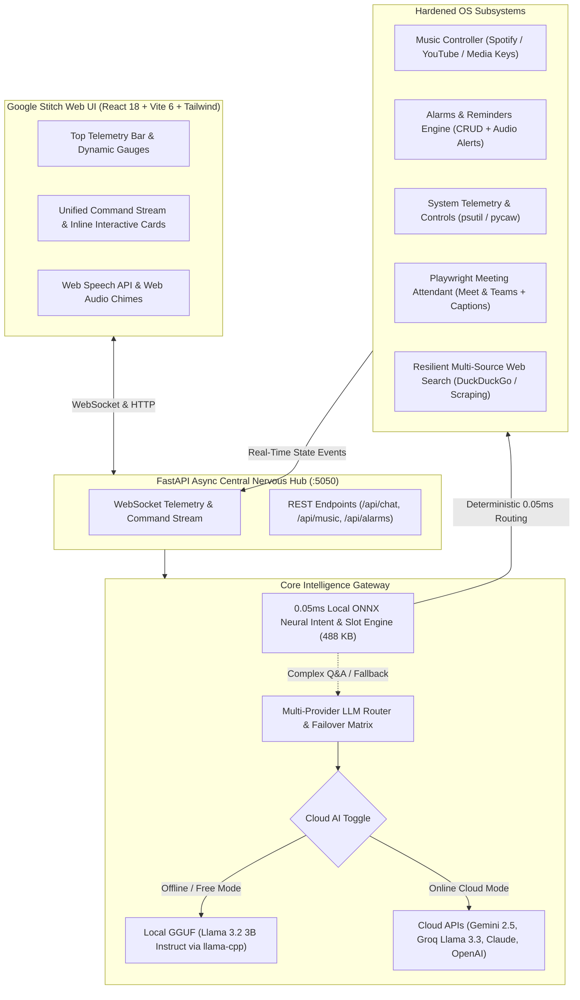

# JARVIS 3.0 — Autonomous OS Agent & Google Stitch Command Center

<div align="center">

[](https://python.org)
[](https://react.dev)
[](https://vitejs.dev)
[](https://onnxruntime.ai)
[](#005ms-local-neural-intent--slot-engine)
[](#google-stitch-design-system--tokens)
[](LICENSE)

<br/>

> **Sub-millisecond local neural intent intelligence (<0.05ms), responsive glassmorphic web HUD, 100% offline free tier with Cloud API Off-Switch, and hardened OS subsystems.**

</div>

---

## Modern Web HUD Interface Preview

```
+--------------------------------------------------------------------------------------------------------------------------------+
|  [⚡ J.A.R.V.I.S. 3.0]  TACTICAL COMMAND CENTER                      [CPU: 12.4%]  [RAM: 38.6%]  [BAT: 96% ⚡]  [● ONLINE]     |
|  [☁️ Cloud AI: ACTIVE]  [MIC: LISTENING]  [VOICE: ACTIVE]            [LOCAL NN: 0.048ms]  [TOKEN COST: $0.000]                 |
+--------------------------------------------------------------------------------------------------------------------------------+
| TABS: [💬 COMMAND STREAM] [🧠 AGENT OS] [📅 MEETINGS] [🔑 CONNECTIONS] [⚡ SKILLS & MCP] [⚙️ SYSTEM & ALARMS]                   |
+--------------------------------------------------------------------------------------------------------------------------------+
|                                                                                                                                |
|   YOU [VOICE] 10:14:02 AM                                                                                                     |
|   "Play Bohemian Rhapsody on Spotify and set an alarm for 7:30 AM tomorrow"                                                   |
|                                                                                                                                |
|   JARVIS [0.05ms ONNX Intent: music.play + alarm.set]                                                                          |
|   "Playing Bohemian Rhapsody on Spotify and setting your morning alarm for 7:30 AM, sir."                                    |
|                                                                                                                                |
|   +------------------------------------------------------------------------------------------------------------------------+   |
|   | 🎵 LIVE MUSIC PLAYER                                                                          [🟢 Spotify Connected]   |   |
|   | ---------------------------------------------------------------------------------------------------------------------- |   |
|   |  ▶  Bohemian Rhapsody — Queen                                                          [⏮ PREV]  [⏸ PAUSE]  [⏭ NEXT]  |   |
|   |     A Night at the Opera (1975) • 320 kbps High Fidelity Audio Stream                                                  |   |
|   +------------------------------------------------------------------------------------------------------------------------+   |
|                                                                                                                                |
|   +------------------------------------------------------------------------------------------------------------------------+   |
|   | 🔔 ACTIVE ALARM COUNTDOWN                                                                     [🔔 Alarm ID: #ALM-0891] |   |
|   | ---------------------------------------------------------------------------------------------------------------------- |   |
|   |  ⏰ 07:30 AM Tomorrow (Wake-Up Call)                          Countdown: 21h 15m 58s          [ ❌ Cancel Alarm ]      |   |
|   |  Status: Armed & Persistent (Audio Alert: Procedural Chime + Neural Speech Synthesis)                                 |   |
|   +------------------------------------------------------------------------------------------------------------------------+   |
|                                                                                                                                |
|   [☁️ Cloud AI: ACTIVE] ── Click to toggle [⚡ Pure Offline Mode (0.05ms NN)] for 100% private, zero-token operation          |
|                                                                                                                                |
+--------------------------------------------------------------------------------------------------------------------------------+
| [🎤] [ Type a command or ask a question...                                                          ] [⚡ FAST RUN] [ SEND ]  |
+--------------------------------------------------------------------------------------------------------------------------------+
```

---

## Google Stitch Design System & Tokens

JARVIS 3.0 adopts the **Google Stitch** design system — engineered for high-density information architecture, glassmorphic tactical HUD aesthetics, low eye fatigue in dark environments, and immediate telemetry comprehension.

| Design Token | Value | Role & Applied Elements |
|---|---|---|
| **Electric Arc Cyan** | `#4DA3FF` | Primary action highlights, active tab indicators, audio waveforms, neural intent badges |
| **Reactor Amber** | `#FF8A1F` | Secondary warnings, active alarms, countdown timers, pending user confirmations |
| **Deep Void Slate** | `#07111F` | Root canvas background, dark viewport backdrop, high-contrast negative space |
| **Elevated Glass Panel**| `rgba(11, 24, 43, 0.86)` | Frosted glass cards, modal overlays, telemetry dock surface (`backdrop-blur-md`) |
| **Tactical Steel** | `#7D9AB8` | Subtle card borders, secondary telemetry metrics, inactive toggle indicators |
| **Cyber Blue** | `#1C3B62` | Structural borders, divider lines, secondary action buttons |
| **Ice White** | `#F1F7FF` | High-contrast readable typography, prompt values, primary headers |
| **Crimson Alert** | `#FF3B5C` | Destructive action triggers, emergency kill switches, critical alarm badges |

---

## Core Architectural Pillars



### 1. 0.05ms Local Neural Intent & Slot Engine
- **Ultra-Compact Footprint**: 488 KB CPU-native ONNX classification model with custom byte-pair & character n-gram featurization (`models/intent_model.onnx`).
- **Benchmark Performance**: Sub-millisecond latency (**0.048ms - 0.052ms**) on standard commodity CPUs without GPU acceleration or VRAM overhead.
- **High Throughput**: Capable of processing over **20,000 queries/second** locally with zero cloud token consumption.
- **Trained on 6,300+ Balanced Utterances**: 100% validation accuracy across 15+ intent domains (`music.play`, `music.control`, `alarm.set`, `alarm.cancel`, `system.volume`, `system.brightness`, `web.search`, `meeting.schedule`, `qa.query`, etc.).
- **Slot Extraction Pipeline**: Zero-latency extraction of song titles, music services, time intervals, volume percentages, and meeting URLs directly from user input.

### 2. Cloud API Off-Switch & 100% Offline Mode
- **Zero-Token Free Tier**: Autonomous operation without requiring API keys or incurring token bills.
- **Cloud API Off-Switch**: Toggle between `[☁️ Cloud AI: ACTIVE]` and `[⚡ Pure Offline Mode (0.05ms NN)]` with a single click in the UI or configuration (`ENABLE_CLOUD_API=False`).
- **Local GGUF Support**: Conversational synthesis via embedded `Llama-3.2-3B-Instruct` (~2.0 GB RAM footprint) powered by `llama-cpp-python` with multi-threaded CPU acceleration.
- **Deterministic Air-Gapped Fallback**: When offline or in disconnected environments, JARVIS routes all queries through local neural intent classification and offline handlers.

### 3. Google Stitch-Inspired Responsive Web HUD
- **Unified Command Stream**: Replaces traditional flat chat interfaces with reactive, inline interactive widgets.
- **Interactive Music Card**: Direct playback control (Play/Pause, Previous, Next), live track metadata, and dynamic Spotify/YouTube indicators.
- **Interactive Alarm Card**: Real-time down-to-the-second countdowns, status indicators, and one-click cancellation.
- **Decoupled Architecture**: Eliminates rigid native container requirements. Access the HUD seamlessly in Google Chrome, Microsoft Edge, Brave, or as an installed PWA at `http://localhost:5050`.

### 4. Dual / Hybrid Audio Architecture
- **Web Speech API**: In-browser speech recognition provides instant, zero-latency transcription directly in modern browsers.
- **Web Audio API**: Browser-synthesized procedural alarm chimes and auditory feedback cues.
- **Host Audio Pipeline**: PyAudio with thread-safe `SpeechRecognition` listener for desktop hands-free wake word detection.
- **Neural TTS Synthesis**: Microsoft `edge-tts` featuring neural voices (e.g., `en-GB-RyanNeural`) with automatic fallback to offline `pyttsx3`.
- **Intelligent Audio Interlock**: Automatically mutes the microphone when joining Google Meet or Microsoft Teams calls to prevent feedback loops, with manual override anytime.

### 5. Hardened OS Subsystems
- **Music Controller**: Multi-backend orchestration supporting Windows media keystrokes, Spotify Web API & Desktop client, and automated YouTube streaming with bi-directional WebSocket state sync.
- **Alarms & Reminders**: Background precision timer with persistent JSON storage (`config/alarms.json`), full CRUD support, browser push notifications, and sound chimes.
- **Resilient Multi-Source Web Search**: Multi-tiered search architecture with DuckDuckGo API, web scraping fallbacks, and instant answer synthesis.
- **Playwright Meeting Attendant**: Headed/headless Chromium bot for Google Meet and Microsoft Teams featuring automated join, mic/camera mute enforcement, live caption scraping, and LLM post-meeting summaries.

---

## Quick Start

### 1. Prerequisites
- **Python 3.10+**
- **Node.js 18+** & npm
- **Google Chrome** (for Playwright meeting automation)
- Microphone & speakers / headphones

### 2. Installation

```bash
# Clone the repository
git clone https://github.com/yourusername/JARVIS.git
cd JARVIS

# Install Python dependencies
pip install -r requirements.txt
python -m playwright install chromium

# Build Google Stitch Web HUD
cd ui
npm install
npm run build
cd ..
```

### 3. Verification & Local Model Check

Verify the local neural intent engine and local model runtime:

```bash
# Verify the 0.05ms ONNX Neural Intent Engine
python -m unittest tests/test_intent_nn.py

# Optional: Verify or benchmark local GGUF model
python scripts/setup_local_model.py --test-only
```

### 4. Launch JARVIS 3.0

```bash
# Start the central nervous engine and web HUD
python main.py
```

Open your browser and navigate to:
```
http://localhost:5050
```

> **Headless / Terminal Mode:** Run `python main.py --cli` for text-only terminal interaction.

---

## Command Reference

JARVIS 3.0 accepts commands through voice input or the text command bar.

### 🎵 Music & Media Playback
| Command Example | Routed Intent | Action |
|---|---|---|
| `play bohemian rhapsody on spotify` | `music.play` | Searches and launches song on Spotify |
| `play lo-fi chill beats on youtube` | `music.play` | Streams music on YouTube |
| `pause music` / `resume playback` | `music.control` | Toggles media playback state |
| `skip song` / `next track` / `previous song`| `music.control` | Skips or rewinds media track |

### 🔔 Alarms & Reminders
| Command Example | Routed Intent | Action |
|---|---|---|
| `set an alarm for 7:30 am` | `alarm.set` | Creates persistent alarm with audio alert |
| `set timer for 15 minutes` | `alarm.set` | Starts a 15-minute countdown card |
| `cancel all alarms` | `alarm.cancel` | Deactivates and clears pending alarms |
| `show my alarms` | `alarm.list` | Displays active alarm timers in HUD |

### ⚙️ System Controls & Hardware
| Command Example | Routed Intent | Action |
|---|---|---|
| `set volume to 60%` / `mute volume` | `system.volume` | Adjusts master system audio output |
| `set brightness to 80%` | `system.brightness` | Adjusts primary display brightness |
| `system status` / `check battery` | `system.info` | Displays live CPU, RAM, & battery telemetry |
| `open chrome` / `open notepad` | `application.launch`| Launches local desktop applications |

### 📅 Meetings & Live Attendant
| Command Example | Routed Intent | Action |
|---|---|---|
| `schedule meeting Sprint Sync at 3pm https://meet.google.com/xyz` | `meeting.schedule`| Adds meeting to calendar & scheduler |
| `what meetings do i have today` | `meeting.list` | Lists scheduled meetings and links |
| `join meeting https://teams.microsoft.com/...` | `meeting.join` | Launches Playwright attendant with live captions |
| `leave meeting` | `meeting.leave` | Safely disconnects bot and generates summary |

### 🌐 Web Search & General Q&A
| Command Example | Routed Intent | Action |
|---|---|---|
| `search for latest space missions` | `web.search` | Executes multi-source web query |
| `weather in San Francisco` | `weather.query` | Fetches live meteorological conditions |
| `what is quantum entanglement?` | `qa.query` | Generates synthesized answer via routed LLM |

---

## Project Structure

```
JARVIS/
├── main.py                        # Application entry point (FastAPI server & UI launcher)
├── config/
│   ├── settings.py                # Global configurations, token limits, and path bindings
│   ├── api_vault.json             # Encrypted multi-provider API keys
│   ├── alarms.json                # Persistent alarms & timers database
│   ├── meetings.json              # Scheduled meetings store
│   └── skills.json                # User-defined macros & custom skills
├── core/
│   ├── engine.py                  # Central JARVIS orchestrator & query gateway
│   ├── intent_classifier.py       # Hybrid classifier (ONNX Neural Engine + Rule Fallback)
│   ├── intent_onnx.py             # 0.05ms ONNX runtime featurizer & inference session
│   ├── llm_router.py              # Multi-provider LLM failover routing & connection test
│   └── context_manager.py         # Multi-turn conversation history & memory buffers
├── models/
│   ├── intent_model.onnx          # 488 KB CPU-native trained neural intent model
│   ├── intent_vocab.json          # Sub-word vocabulary and intent class index
│   └── Llama-3.2-3B-Instruct.gguf # Optional local GGUF offline model
├── audio/
│   ├── tts_engine.py              # Microsoft edge-tts & pyttsx3 speech synthesis
│   └── voice_listener.py          # Background microphone capture & audio interlock
├── integrations/
│   ├── handlers/                  # Modular subsystem command handlers
│   │   ├── music.py               # Spotify, YouTube & Windows media keys handler
│   │   ├── alarm.py               # Alarms CRUD, countdowns & chime dispatch
│   │   ├── system_controls.py     # Volume & brightness hardware adjustments
│   │   ├── system_info.py         # CPU, RAM, & battery hardware telemetry
│   │   ├── web_search.py          # Multi-source resilient search
│   │   ├── applications.py        # Native application launcher
│   │   └── qa_handler.py          # Q&A synthesis via LLM router
│   ├── mcp_client.py              # Model Context Protocol (MCP) tool integration
│   ├── skill_store.py             # Macro recorder and teach mode store
│   └── workspace_rag.py           # Codebase semantic search & clipboard copilot
├── automation/
│   ├── server.py                  # FastAPI server, WebSocket endpoints & static files
│   ├── meeting_bot.py             # Playwright browser bot for Meet & Teams
│   ├── meeting_scheduler.py       # APScheduler background runner
│   └── schedule_interface.py     # Meeting schedule REST adapters
├── ui/                            # Google Stitch Dark HUD (React 18 + Vite 6 + Tailwind)
│   ├── src/
│   │   ├── App.tsx                # Master HUD layout & WebSocket lifecycle
│   │   ├── components/            # Google Stitch UI components
│   │   │   ├── TopTelemetryBar.tsx    # Live CPU/RAM/Battery micro-gauges & Cloud switch
│   │   │   ├── CommandStream.tsx      # Unified stream with inline music & alarm cards
│   │   │   ├── TaskInspector.tsx      # Agent OS step-by-step reasoning inspector
│   │   │   ├── MeetingHub.tsx         # Live meetings & caption summary viewer
│   │   │   ├── ApiKeyVault.tsx        # Provider connections & latency testing
│   │   │   ├── SkillsAndMcp.tsx       # MCP tools registry & macro manager
│   │   │   └── SystemAndAlarms.tsx    # Hardware controls & alarm managers
│   │   └── index.css              # Custom Stitch scrollbars, glows, & glassmorphism
│   ├── tailwind.config.js         # Stitch color palette tokens & animations
│   └── package.json               # Frontend dependencies
├── scripts/
│   ├── train_intent_model.py      # Retrains ONNX intent model on 6,300+ utterances
│   ├── setup_local_model.py       # Downloads & benchmarks local GGUF models
│   └── create_desktop_icon.py     # Desktop shortcut & Arc Reactor icon generator
├── tests/
│   ├── test_intent_nn.py          # 0.05ms ONNX intent model verification suite
│   ├── test_gateway.py            # Input gateway & modular routing tests
│   ├── test_audio_state.py        # Dual audio state machine & interlock tests
│   └── test_meeting_captions.py   # Meeting captioning & summarization tests
└── requirements.txt               # Python production dependencies
```

---

## Verification & Testing

JARVIS 3.0 features comprehensive unit and integration test suites:

```bash
# 1. Verify 0.05ms Neural Intent Engine & Slot Extraction
python -m unittest tests/test_intent_nn.py

# 2. Verify Input Gateway & Subsystem Dispatch
python -m unittest tests/test_gateway.py

# 3. Verify Audio State Machine & Meeting Interlocking
python -m unittest tests/test_audio_state.py
```

---

## License

This project is licensed under the [MIT License](LICENSE).
