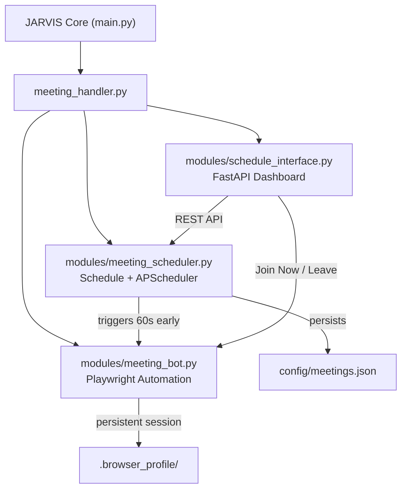
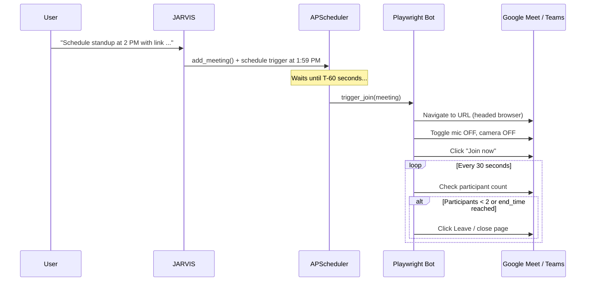

# 🤖 JARVIS Meeting Attendant Module — Setup & Usage Guide

## Architecture Overview



## Files Created / Modified

| File | Action | Purpose |
|------|--------|---------|
| [`modules/__init__.py`](file:///d:/Projects,%20hackathons/JARVIS/modules/__init__.py) | **New** | Package marker |
| [`modules/meeting_bot.py`](file:///d:/Projects,%20hackathons/JARVIS/modules/meeting_bot.py) | **New** | Headed Playwright browser automation for Google Meet & Teams |
| [`modules/meeting_scheduler.py`](file:///d:/Projects,%20hackathons/JARVIS/modules/meeting_scheduler.py) | **New** | Schedule persistence (JSON), APScheduler trigger engine, NLP parsing |
| [`modules/schedule_interface.py`](file:///d:/Projects,%20hackathons/JARVIS/modules/schedule_interface.py) | **New** | FastAPI web dashboard + REST API at `localhost:5050` |
| [`meeting_handler.py`](file:///d:/Projects,%20hackathons/JARVIS/meeting_handler.py) | **New** | Top-level handler bridging modules into JARVIS core |
| [`config/meetings.json`](file:///d:/Projects,%20hackathons/JARVIS/config/meetings.json) | **New** | Persistent meeting schedule storage |
| [`core.py`](file:///d:/Projects,%20hackathons/JARVIS/core.py) | **Modified** | Import + handler init + command dispatch + AI prompt |
| [`requirements.txt`](file:///d:/Projects,%20hackathons/JARVIS/requirements.txt) | **Modified** | Added `playwright`, `APScheduler`, `fastapi`, `uvicorn` |
| [`.env`](file:///d:/Projects,%20hackathons/JARVIS/.env) / [`.env.example`](file:///d:/Projects,%20hackathons/JARVIS/.env.example) | **Modified** | Added `MEETING_DASHBOARD_PORT/HOST` |
| [`.gitignore`](file:///d:/Projects,%20hackathons/JARVIS/.gitignore) | **Modified** | Excludes `.browser_profile/` and `config/meetings.json` |

---

## Setup Instructions

### 1. Install Dependencies

```bash
pip install -r requirements.txt
python -m playwright install chromium
```

### 2. One-Time Browser Login (Critical!)

> [!IMPORTANT]
> You must log into your Google and Microsoft accounts once in the persistent browser so the bot can join calls without re-authentication.

```bash
python -m modules.meeting_bot --setup
```

This opens a headed Edge browser with two tabs:
1. **Google Accounts** — log in to your Google account (for Google Meet)
2. **Microsoft Online** — log in to your Microsoft account (for Teams)

**Close the browser window** when done. Your session is saved to `.browser_profile/` and will be reused automatically.

### 3. Start JARVIS

```bash
python main.py
```

On startup you'll see:
```
[✓] Meeting attendant module ready
[ScheduleInterface] Dashboard running at http://127.0.0.1:5050
```

---

## Voice Commands

| Say this | What happens |
|----------|--------------|
| *"Schedule Team Standup at 2:30 PM with link https://meet.google.com/abc"* | Adds meeting, bot joins 60s early |
| *"What meetings do I have today?"* | Reads out today's schedule |
| *"Cancel my next meeting"* | Cancels the next pending meeting |
| *"Join the meeting"* / *"Join now"* | Immediately joins the next pending meeting |
| *"Leave the meeting"* | Force-exits the active Playwright session |
| *"Open schedule dashboard"* | Opens `http://localhost:5050` in your browser |

---

## Web Dashboard

Access at **http://127.0.0.1:5050** (or say *"Jarvis, open schedule dashboard"*).

### Features
- **Quick-Add Form** — Name, URL, start time, duration
- **Today's Timeline** — Live view of all meetings with status badges (pending/active/completed/cancelled)
- **Manual Overrides** — "Join Now" and "Cancel" buttons on each pending meeting
- **Bulk Importer** — Paste a JSON array to schedule multiple meetings at once

### REST API Endpoints

| Method | Endpoint | Description |
|--------|----------|-------------|
| `GET` | `/api/meetings` | List all meetings |
| `GET` | `/api/meetings/today` | Today's meetings only |
| `GET` | `/api/meetings/pending` | Future pending meetings |
| `POST` | `/api/meetings` | Add a new meeting |
| `DELETE` | `/api/meetings/{id}` | Cancel a meeting |
| `POST` | `/api/meetings/{id}/join` | Force-join a meeting now |
| `POST` | `/api/meetings/leave` | Leave active meeting |
| `POST` | `/api/meetings/bulk` | Bulk import (JSON array) |

---

## How Auto-Join Works



---

## Non-Blocking Architecture

> [!NOTE]
> All meeting subsystems run in independent daemon threads — they never block JARVIS's primary audio capture, TTS, or main event loop.

- **APScheduler** — Background daemon thread polling the schedule queue
- **FastAPI Dashboard** — Uvicorn runs in a daemon thread
- **Playwright Bot** — Each `join_meeting()` call runs in its own daemon thread
- **JARVIS Main Loop** — Continues listening for voice commands uninterrupted

---

## Bulk Import JSON Format

```json
[
  {
    "title": "Monday Standup",
    "meeting_url": "https://meet.google.com/abc-defg-hij",
    "start_time": "2026-10-13T09:00:00",
    "end_time": "2026-10-13T09:30:00",
    "auto_leave": true
  },
  {
    "title": "Sprint Planning",
    "meeting_url": "https://teams.microsoft.com/l/meetup-join/...",
    "start_time": "2026-10-13T14:00:00",
    "end_time": "2026-10-13T15:00:00"
  }
]
```
